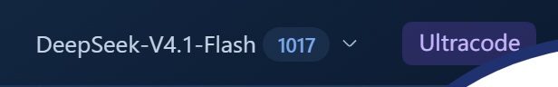
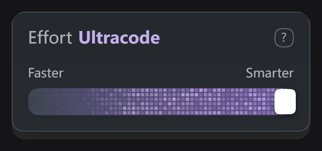
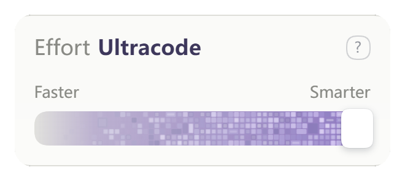
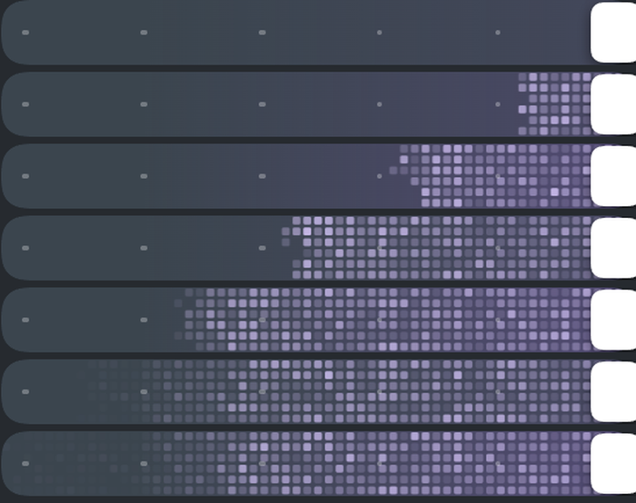

<div align="center">

[中文](../../README.md) · [English (UK)](README_EN_UK.md) · [English (US)](README_EN_US.md) · [Français](README_FR.md) · **Русский**

<h1>dsh-claude-effort-slider</h1>

**Шестипозиционный ползунок уровня рассуждений в стиле Claude Code для [DeepSeek Harness](https://github.com/deepseek-ai/deepseek-harness).**
Шестая позиция — **Ultracode** — превращает дорожку в полосу лавандовых пикселей, бегущую влево.

[](../../LICENSE)
[](https://github.com/deepseek-ai/deepseek-harness)
[](https://github.com/youqisibun/dsh-claude-effort-slider/releases)
[](https://github.com/topics/dsh-plugin)

</div>

---

> [!NOTE]
> **Правовая информация**
>
> Это неофициальный сторонний плагин. Он **не связан с Anthropic или DeepSeek, не одобрен и не спонсируется ими**, и не получил от них никаких разрешений.<br>
> Названия «Claude», «Claude Code» и «Ultracode» приведены только для описания источника визуального вдохновения; **все соответствующие товарные знаки и права интеллектуальной собственности принадлежат их владельцам**.<br>
> Проект не содержит официального кода или ресурсов — каждый элемент интерфейса и каждая анимация отрисовываются во время выполнения кодом из этого репозитория.
>
> Этот документ — перевод [китайского оригинала](../../README.md); при расхождениях приоритет имеет китайская версия.

---









---

## Возможности

- **Отдельный чип**: справа от поля ввода появляется чип Effort — щелчок открывает, повторный закрывает. Кнопка модели отвечает только за выбор модели.
- **Ползунок на шесть позиций**: `Low / Medium / High / Extra / Max / Ultracode`. Перетаскивание показывает предпросмотр, отпускание применяет.
- **Текстура Ultracode**: заполнение справа налево (1,6 с), затем по каждой строке идёт импульс влево. Повторное открытие панели **не воспроизводит** анимацию — она повторяется только при возврате на последнюю позицию.
- **Адаптация к светлой и тёмной теме**: панель и текстура следуют теме интерфейса — сетка лавандовых точек на тёмной, лавандовая мозаика на светлой.
- **Управление с клавиатуры**: `←/→` и `Home/End` меняют позицию, `Esc` закрывает.
- **Реальная запись**: каждая позиция вызывает `directory.select({ reasoningEffort })` в DSH — это не просто смена текста.
- **Обратимость**: отключение или удаление возвращает штатное управление. Файлы хоста не изменяются.

---

## Установка

Требования: **DSH ≥ 0.2.1-rc.2**, **Node.js ≥ 22**.

### Из GitHub (рекомендуется)

```bash
dsh plugin --profile web add github:youqisibun/dsh-claude-effort-slider
```

После установки **полностью закройте DSH и запустите снова** (закрыть окно недостаточно — процесс должен завершиться).

### В настольную версию (Electron)

`desktop` — профиль, зарезервированный за Electron; установка из командной строки невозможна. Используйте прилагаемый скрипт:

```powershell
.\install.cmd -Profile desktop
# Удаление:
.\install.cmd -Profile desktop -Uninstall
```

Скрипт создаёт резервную копию `package.json` профиля, добавляет зависимость `link:`, записывает имя пакета в `dsh.profile.bundles` и создаёт ссылку в `node_modules`.

### Из tarball-архива

```bash
dsh plugin --profile web add ./dsh-claude-effort-slider-0.9.4.tgz
```

---

## Использование

| Действие | Поведение |
|---|---|
| Щелчок по чипу | Открыть / закрыть панель |
| Перетаскивание по дорожке | Предпросмотр в реальном времени; **применение при отпускании** (избегает повторных записей сессии и конфликтов блокировки) |
| `←/→`, `Home/End` | Смена позиции с клавиатуры |
| Правый щелчок по дорожке | Деления, интенсивность текстуры, сброс к значениям по умолчанию |
| Щелчок вне панели / `Esc` | Закрыть |

Записи выполняются последовательно: одновременно допускается только один `select`. Если блокировку записи держит другой плагин, выполняется автоматический повтор, а откат с уведомлением происходит только через 10 секунд.

---

## Что означают шесть позиций

В DSH реально существует всего четыре значения `reasoning effort` — **off / low / high / max**. Шесть позиций — это визуальное отображение:

| Позиция | Записывается в DSH | Примечание |
|---|---|---|
| Low | `off` | Рассуждения отключены |
| Medium | `low` | Низкая интенсивность |
| High | `high` | Высокая интенсивность |
| Extra | `high` | Визуальное деление, как High |
| Max | `high` | Визуальное деление, как High |
| **Ultracode** | `max` | Максимальная интенсивность + пиксельная текстура |

> Две из позиций Medium / Extra / Max записывают то же значение, что и соседняя — **это следствие того, что в DSH всего четыре уровня, а не ошибка**. Ultracode действительно соответствует `max`; плагин не меняет промпты и не запускает субагентов.

---

## Параметры текстуры Ultracode

- Сетка: **6 строк × 60 столбцов**, ячейка 4,67 px
- Тёмная тема: блоки занимают 72 % ячейки (≈3,36 px), сетка лавандовых точек
- Светлая тема: блоки занимают 88 % (зазор около 12 %), лавандовая мозаика поверх непрерывного градиента от серого к фиолетовому
- Заполнение: **1,6 с**, фронт отступает справа налево с неровностью края ±2,5 %
- Покой: по две волны на строку с **одинаковой фазовой скоростью**, поэтому текстура смещается только влево; длина волны, скорость и фаза случайны для каждой строки
- Движение: ячейки светлеют при проходе гребня, их сердцевина вспыхивает белым; наступающий фронт мигает ячейка за ячейкой при перетаскивании; «внешнее пламя» слева мерцает случайно
- Фиолетовое свечение растёт вместе с фронтом и покрывает всю дорожку только после заполнения
- Деления автоматически скрываются на последней позиции
- Панель и текстура автоматически следуют теме интерфейса — ручная настройка не нужна

Чтобы изменить скорость, плотность или яркость, см. справочник параметров в [`ANIMATION.md`](../../ANIMATION.md).

---

## Совместимость

- Проверено на **DSH 0.2.1-rc.2** (веб + настольная версия); для других версий может потребоваться повторная проверка.
- Плагин опирается на структуру DOM официального места модели. Если официальный редизайн сделает её неузнаваемой, плагин вернётся к собственному чипу — функции не меняются, официальный интерфейс не ломается.
- Совместим с другими плагинами, переписывающими официальное управление рассуждениями; оба можно установить одновременно.

---

## Частые вопросы

**После установки ничего не происходит?**
Клиентский бандл внедряется при запуске — нужно **полностью закрыть DSH и запустить снова**.

**Не удаётся установить в настольную версию?**
Профиль `desktop` не принимает `dsh plugin`; используйте `install.cmd -Profile desktop`.

**Хочется ещё раз увидеть анимацию после максимума?**
Закрытие и открытие панели её не повторяет (так задумано); уведите ползунок с последней позиции и верните обратно, чтобы воспроизвести один раз.

**Нативный интерфейс не вернулся после удаления?**
Выполните `install.cmd -Profile desktop -Uninstall` для полного удаления, затем перезапустите.

---

## Разработка

```bash
npm test          # 38 офлайн-проверок: соответствие позиций / геометрия / текстура / настройки / структура бандла
npm run pack      # сборка пакета в dist/
```

Этапа сборки нет: `lib/client.js` — это готовый артефакт (`react` / `react-dom` предоставляет хост).

```
lib/index.js      Хостовая половина: пустой apply + статическая проверка клиентского артефакта
lib/client.js     Клиентская половина: мост чипа, панель, ползунок, пиксельная текстура, работа с каталогом
cordis.patch.yml  Подключает пакет в дерево плагинов cordis
```

---

## Лицензия

MIT
